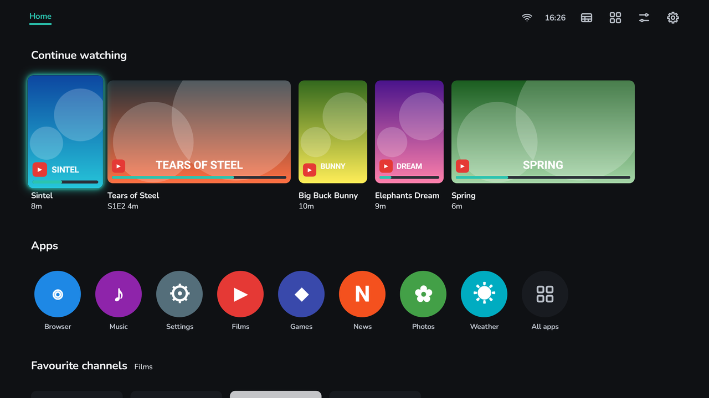
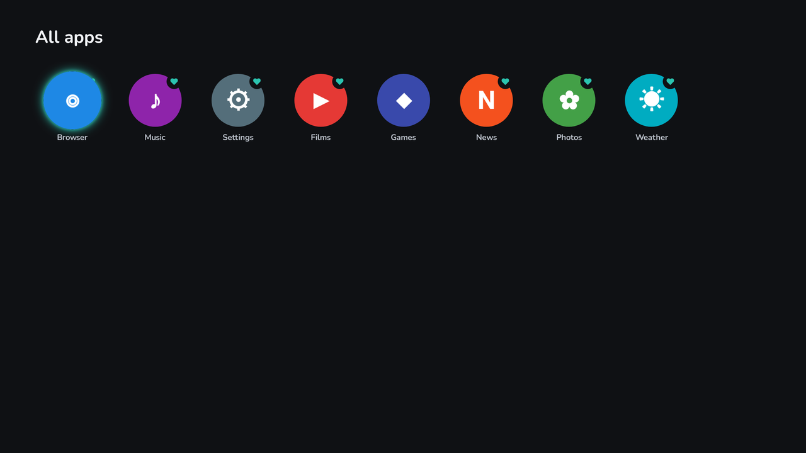

# MyTVLauncher

A light home screen for Android TV and Google TV, with no ads, no tracking and no analytics. It has the same look as
[MyTVPlayer](https://github.com/biskyt/MyTVPlayer) and [MyPlexPlayer](https://github.com/biskyt/MyPlexPlayer).

## Why MyTVLauncher
- **No ads, no tracking:** no analytics, no account and no sponsored rows. Open source (GPL-3.0).
- **Light and quick:** Built to start-up instantly, even on low-power devices
- **Made for the TV remote:** every screen works with the D-pad. Supports options key and TV Guide key (for use with optional guide override)
- **Simple, uncomplicated user experience:** No complex options, just install and go
- **Supports standard Android TV features:** Supports _Next up_ and home channels for any app that provides these features (e.g, MyTVPlayer, MyPlexPlayer, Plezy, My5, etc)

## Features
- **Continue watching:** other apps' Watch Next items, up to 20. Each card shows a poster or a wide picture, a progress
  bar, the episode and the time left (for example "S1E2 22m"), and its app's icon.
- **Favourite apps:** round app icons on Home. Hold OK on an app to move it or to remove it from favourite apps.
- **App channels:** the rows that apps give the TV, such as MyTVPlayer's favourite channels. Turn these on in Settings->Home rows
- **Your rows, your order:** turn each row on or off, choose which apps' items show, and move the rows up and down.
- **All apps:** every app on the TV. A heart marks your favourite apps.
- **Recent apps:** Double-click the Home button on your remote to see the apps you used last.
- **TV guide button:** opens the TV's own guide, MyTVPlayer's or MyPlexPlayer's.
- **Notifications:** an optional bell in the top bar shows the TV's notifications. Requires notifications permission, off by default
- **Speaker wake:** optionally wakes a soundbar or receiver from sleep when the TV wakes, by playing a short silent tone.
- **Backup and restore:** Export your settings to a file and restore them later (or copy to another TV).
- **Accent colour** Choose your preferred colour for menu and highlight accents.
- **Languages:** English, Spanish, Portuguese (Brazil) and French.

| All apps | Recent apps |
| --- | --- |
|  |  |

The screenshots use stand-in apps and pictures.

## Install
Download the APK from [Releases](https://github.com/biskyt/MyTVLauncher/releases) and sideload it. 

## Permisions
Some features need a permission MyTVLauncher will ask for these permissions only when you first use the feature:
- Continue watching and app channels need the TV listings permission
- Recent apps need usage access is needed for showing Recent Apps.
- Notifications need notification access

## Privacy
MyTVLauncher sends nothing about you anywhere. Its only network use is to load the pictures that other apps give to
Watch Next and their channels. It reads other apps' Watch Next items only with your permission.

## Build
- `./gradlew :app:assembleDebug` builds a debug APK.
- `./gradlew ktlintCheck detekt lintDebug` and `./gradlew :core:test :app:testDebugUnitTest` run the CI checks.

## Licence
GPL-3.0. See [LICENSE](LICENSE).

# Make MyTVLauncher the default launcher
Some TVs will ask you to choose a default launcher the first time you press the home button after installing a new launcher application. But many are locked down by their manufacturers to force you to use their default launcher, filled with ads that they get paid for. Fear not, it is still possible to change the launcher in most cases. There are many methods, but the below is my tried and tested ones:

## AndroidTV and Google TV
- IMPORTANT: First, install MyTVLauncher and run it for the first time. You must have a new launcher configured before you disable the old one!
- On the TV, turn on Developer options and USB or network debugging. Thre are plenty of guides to enable developer options, look them up. The short version is goto Settings->About and click on the build numbner 7 times
- In Developer options, enable ADB debugging (USB or network debugging)
- From the play store, download [ADB TV: App Manager](https://play.google.com/store/apps/details?id=com.cybercat.adbappcontrol.tv) from Cyber.cat.
- Open ADB TV: App manager and allow its permissions
- **For Android TV:**
  - Find `com.google.android.tvlauncher` in the apps list (it may also be listed as Android TV Home)
  - - Select disable to disable it
- **For Google TV**
  - Find `com.google.android.apps.tv.launcherx`
  - Select disable to disable it
  - Find `com.google.android.tungsten.setupwraith`
  - Select disable to disable it
- Press the home button
- Either: MyTVLauncher will open, or you will be prompted to select your default home app. In which case choose MyTVLauncher and Always

### ADB commands (Alternative to the above)
- **Android TV**: `adb shell pm disable-user --user 0 com.google.android.tvlauncher`
- **Google TV**: `adb shell pm disable-user --user 0 com.google.android.apps.tv.launcherx` and `adb shell pm disable-user --user 0 com.google.android.tungsten.setupwraith`
- Press Home. If the TV asks which app to use, select MyTVLauncher and "Always". Where the TV allows it, this also works: `adb shell cmd package set-home-activity com.biskyt.mytvlauncher/.MainActivity`.

## Amazon Fire TV and Fire TV sticks
- You will need to root your Fire TV device first. Search google for instructions for your specific device and version, as the instructions change regularly

## Restoring the default launcher
- To restore the default launcher, you can re-enable the packages that you disabled and press the home button
