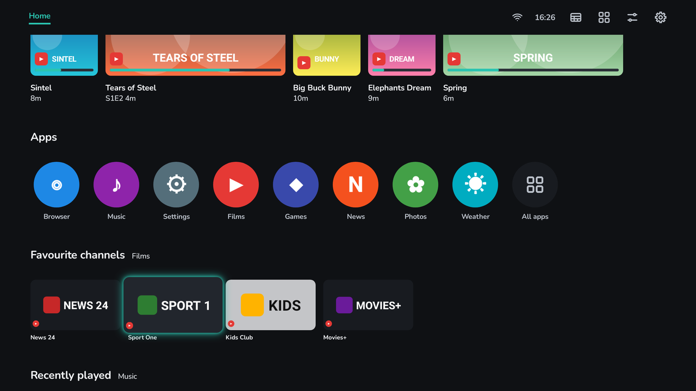
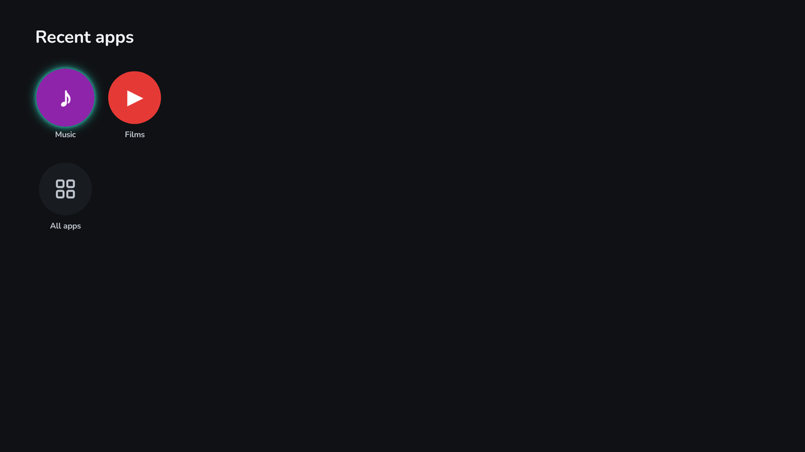
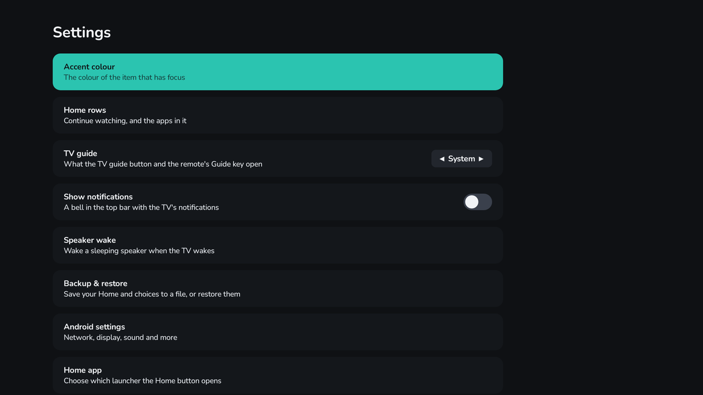

# MyTVLauncher

A light home screen for Android TV and Google TV, with no ads, no tracking and no analytics. It has the same look as
[MyTVPlayer](https://github.com/biskyt/MyTVPlayer) and [MyPlexPlayer](https://github.com/biskyt/MyPlexPlayer).

## Why MyTVLauncher
- **No ads, no tracking:** no analytics, no account and no sponsored rows. Open source (GPL-3.0).
- **Light and quick:** Home shows straight away from what it saved last time. It reads other apps' rows in the
  background, and it loads pictures only for the rows that are on.
- **Made for the remote:** every screen works with the D-pad. The card with focus grows and glows in your accent
  colour.
- **Always a way out:** every app and Android settings open from MyTVLauncher, so you can change back to another home
  app at any time.

## Features
- **Continue watching:** other apps' Watch Next items, up to 20. Each card shows a poster or a wide picture, a progress
  bar, the episode and the time left (for example "S1E2 22m"), and its app's icon.
- **Favourite apps:** round app icons on Home. Hold OK on an app to move it or to remove it from favourite apps.
- **App channels:** the rows that apps give the TV, such as MyTVPlayer's favourite channels. TV channel logos are all
  the same size, and a dark logo shows on a light card.
- **Your rows, your order:** turn each row on or off, choose which apps' items show, and move the rows up and down.
- **All apps:** every app on the TV. A heart marks your favourite apps.
- **Recent apps:** press Home twice to see the apps you used last.
- **TV guide button:** opens the TV's own guide, MyTVPlayer's or MyPlexPlayer's. The remote's Guide key does the same.
- **Notifications:** an optional bell in the top bar shows the TV's notifications.
- **Speaker wake:** optionally wakes a soundbar or receiver that sleeps when the TV wakes.
- **Backup and restore:** your Home and choices in one file.
- **Accent colour** and a clock, the network status and a VPN badge in the top bar.
- **Languages:** English, Spanish, Portuguese (Brazil) and French.

| All apps | Recent apps |
| --- | --- |
|  |  |

The screenshots use stand-in apps and pictures.

## Install
Download the APK from [Releases](https://github.com/biskyt/MyTVLauncher/releases) and sideload it. To make it the TV's
home app, see [RELEASING.md › Make MyTVLauncher the home app](RELEASING.md#make-mytvlauncher-the-home-app).

Some features need a permission that a TV often has no screen for. MyTVLauncher shows the `adb` command for each one:
- Continue watching and app channels need the TV listings permission. MyTVLauncher asks for it.
- Recent apps need usage access.
- Notifications need notification access. MyTVLauncher asks for it when you turn the bell on.

## Privacy
MyTVLauncher sends nothing about you anywhere. Its only network use is to load the pictures that other apps give to
Watch Next and their channels. It reads other apps' Watch Next items only with your permission.

## Build
- `./gradlew :app:assembleDebug` builds a debug APK.
- `./gradlew ktlintCheck detekt lintDebug` and `./gradlew :core:test :app:testDebugUnitTest` run the CI checks.

## Licence
GPL-3.0. See [LICENSE](LICENSE).
